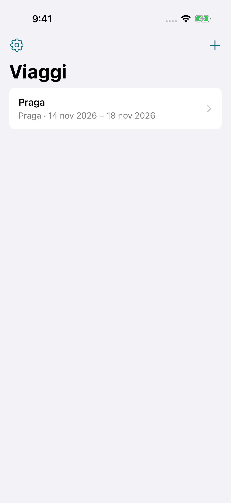
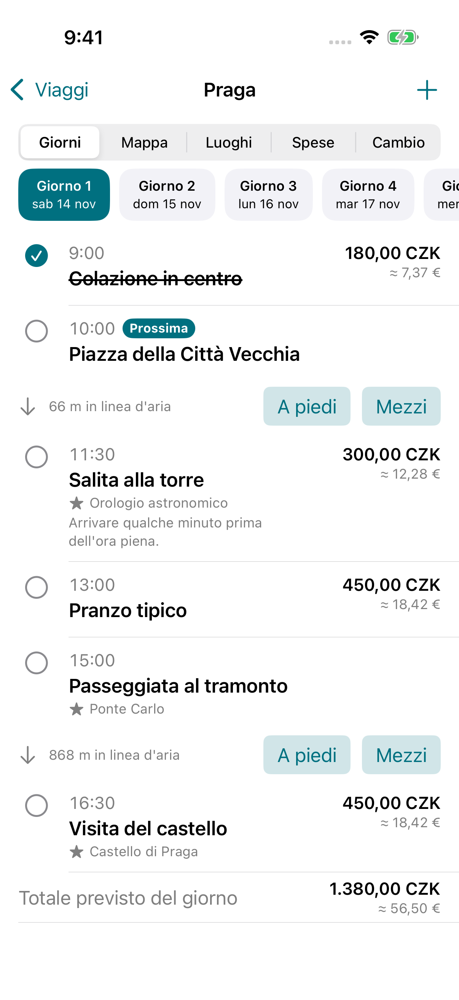
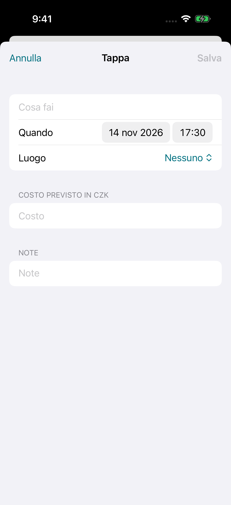
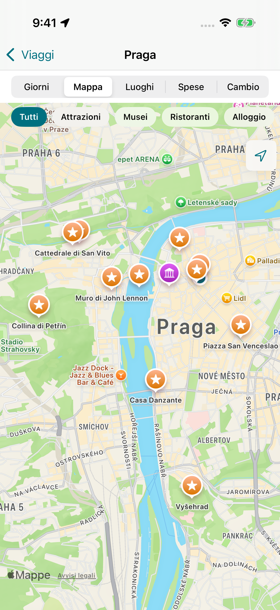
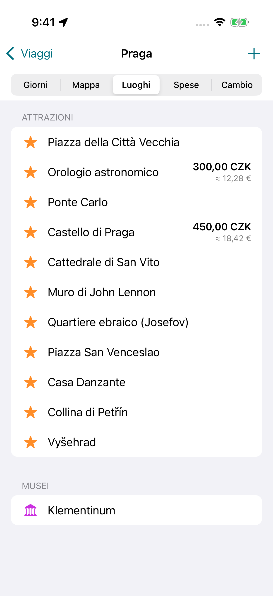
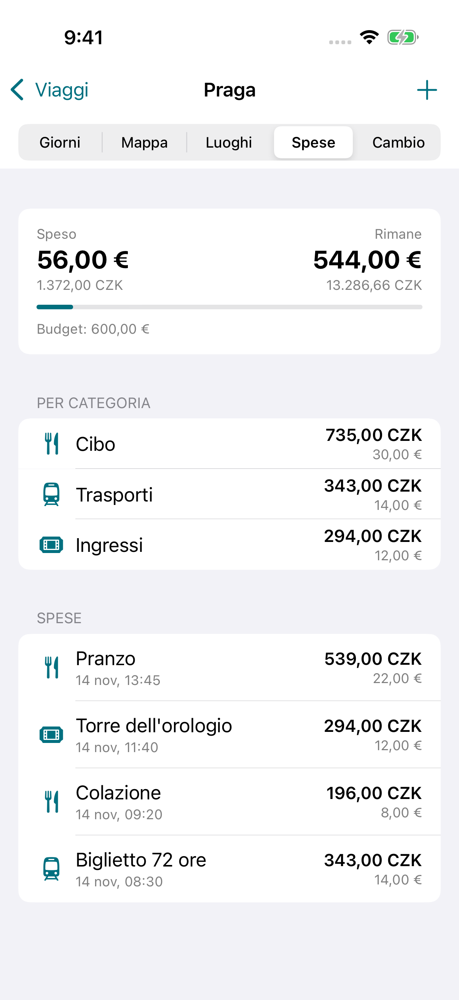
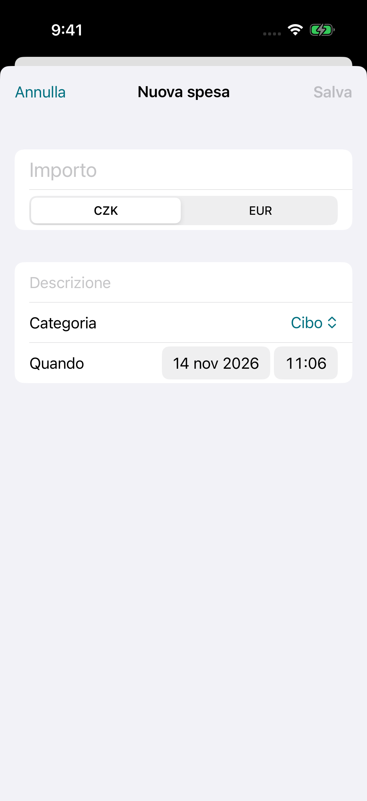
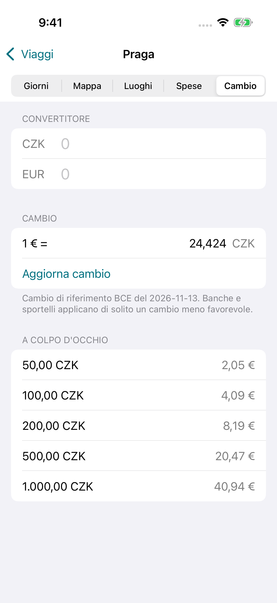

# Report grafico Itinera

- Commit: `5d51406`
- Simulatore: iPhone 17 (iOS 26.2)
- Esito dei test delle schermate: **superati**
- Screenshot acquisiti: 8

## Analisi visiva (Claude)

Analisi automatica non eseguita: il secret `ANTHROPIC_API_KEY` non è configurato. Le schermate sono comunque pronte per essere analizzate da Claude in chat.

## Controllo automatico di accessibilità (Xcode)

| Schermata | Tipo | Problema | Dettaglio | Elementi |
|---|---|---|---|---|
| 01-Elenco-viaggi | contrasto | Contrast nearly passed | Contrast is not high enough for SwiftUI.AccessibilityNode unless font size is larger. | 1 |
| 02-Giorni | area di tocco piccola | Hit area is too small | The size of this SwiftUI.AccessibilityNode is too small for user to interact. | 21 |
| 02-Giorni | contrasto | Contrast nearly passed | Contrast is not high enough for SwiftUI.AccessibilityNode unless font size is larger. | 22 |
| 03-Nuova-tappa | contrasto | Contrast failed | Contrast failed for SwiftUI.AccessibilityNode | 2 |
| 03-Nuova-tappa | contrasto | Contrast nearly passed | Contrast is not high enough for SwiftUI.AccessibilityNode unless font size is larger. | 1 |
| 03-Nuova-tappa | testo tagliato | Text clipped | Text of this UILabel may be clipped at larger Dynamic Type sizes. | 1 |
| 05-Luoghi | area di tocco piccola | Hit area is too small | The size of this SwiftUI.AccessibilityNode is too small for user to interact. | 16 |
| 05-Luoghi | contrasto | Contrast nearly passed | Contrast is not high enough for SwiftUI.AccessibilityNode unless font size is larger. | 3 |
| 05-Luoghi | contrasto | Contrast failed | Contrast failed for SwiftUI.AccessibilityNode | 1 |
| 06-Spese | area di tocco piccola | Hit area is too small | The size of this SwiftUI.AccessibilityNode is too small for user to interact. | 17 |
| 06-Spese | contrasto | Contrast nearly passed | Contrast is not high enough for SwiftUI.AccessibilityNode unless font size is larger. | 17 |
| 06-Spese | contrasto | Contrast failed | Contrast failed for SwiftUI.AccessibilityNode | 1 |
| 07-Nuova-spesa | contrasto | Contrast failed | Contrast failed for SwiftUI.AccessibilityNode | 1 |
| 08-Cambio | testo tagliato | Text clipped | Text of this UITextField may be clipped at larger Dynamic Type sizes. | 1 |
| 08-Cambio | contrasto | Contrast nearly passed | Contrast is not high enough for SwiftUI.AccessibilityNode unless font size is larger. | 12 |

## Schermate

### 01-Elenco-viaggi

### 02-Giorni

### 03-Nuova-tappa

### 04-Mappa

### 05-Luoghi

### 06-Spese

### 07-Nuova-spesa

### 08-Cambio

